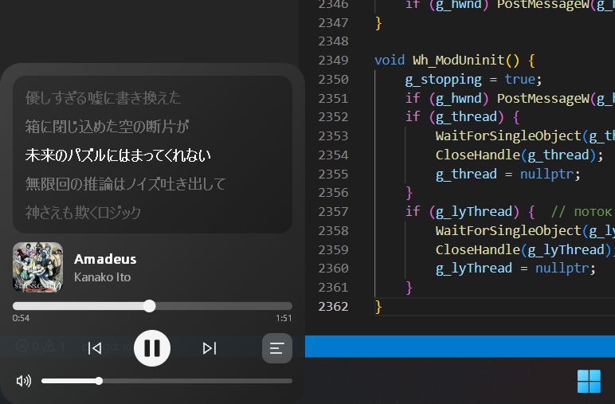

# Taskbar Music Widget

Мод для [Windhawk](https://windhawk.net): прозрачный виджет «сейчас играет» прямо на панели задач Windows. По правому клику он раскрывается в «остров» в стиле Dynamic Island: перемотка, громкость конкретного приложения, синхронизированный текст песни и цвета, которые подстраиваются под обложку трека.

> По умолчанию настроен на Яндекс Музыку, но работает с любым приложением, которое отдаёт медиа-информацию в Windows (Spotify, браузеры, плееры и т. д.).

<!-- Добавьте скриншоты: docs/compact.png, docs/expanded.png, docs/lyrics.png -->

## Возможности

### Компактный режим
- Обложка, название и исполнитель на панели задач, без фона.
- При наведении появляются кнопки «назад», «пауза/играть», «вперёд».
- Клик открывает приложение, повторный клик прячет его в трей.
- Виджет сам скрывается, когда другое приложение работает в полноэкранном режиме.
- Учитывает DPI, масштабируется целиком одной настройкой (50–200 %).

### Развёрнутый плеер (правый клик)
- Большая обложка, шкала воспроизведения с таймингами (клик или перетаскивание — перемотка), кнопки управления.
- **Громкость только целевого приложения** (его отдельная сессия в микшере Windows), кнопка отключения звука, регулировка колесом мыши с настраиваемым шагом.
- **Динамическая палитра**: градиент фона, текст и акценты берутся из обложки и плавно перетекают при смене трека.
- Настраиваемая прозрачность фона.
- **Текст песни**: кнопка рядом с управлением открывает панель сверху. Текущая строка подсвечивается и плавно прокручивается, клик по строке перематывает к ней, колесо мыши листает текст. Тексты берутся с [LRCLIB](https://lrclib.net).
- Анимации: пружинное раскрытие, поэтапное появление элементов, плавная смена обложки, эффекты при наведении и нажатии.
- Сворачивание при уходе курсора: сразу, через паузу или никогда.

## Установка

1. Установите [Windhawk](https://windhawk.net).
2. В Windhawk создайте новый мод («Create a new mod»), вставьте содержимое [`main_wh.cpp`](main_wh.cpp) и нажмите «Compile mod».
3. Включите мод и откройте его настройки.

## Первая настройка

1. **Путь к exe приложения** — нужен, чтобы открывать и прятать приложение по клику и находить его аудио-сессию для регулятора громкости.
2. **Фильтр источника музыки** — часть AppUserModelId медиа-сессии (например `yandex`, `spotify`). Пусто — берётся текущая системная сессия.
3. При желании подберите привязку, сдвиг, размер, ширину и цвет текста.

## Настройки

| Настройка | Описание |
| --- | --- |
| Путь к exe приложения | Что открывать/прятать по клику; по имени exe ищется аудио-сессия для громкости |
| Фильтр источника музыки | Часть AppUserModelId (без учёта регистра); пусто — текущая системная сессия |
| Привязка, сдвиг по горизонтали | Положение виджета на панели задач |
| Размер плеера (%) | Масштаб всего виджета, 50–200 |
| Ширина, размер шрифта, цвет текста | Внешний вид компактного режима |
| Сворачивание после ухода курсора | Сразу / через паузу / не сворачивать (правый клик переключает всегда) |
| Пауза до сворачивания (сек) | Для режима «через паузу» |
| Непрозрачность фона (%) | Фон развёрнутого плеера, 5–100 |
| Шаг громкости колесом (%) | Изменение громкости за один щелчок колеса, 1–50 |
| Сдвиг синхронизации текста (мс) | Если строки текста опаздывают или спешат |

## Управление

| Действие | Результат |
| --- | --- |
| Наведение (компактный режим) | Показать кнопки назад / пауза / вперёд |
| Левый клик | Открыть приложение / спрятать его в трей |
| Правый клик | Развернуть или свернуть плеер |
| Клик или перетаскивание по шкале | Перемотка |
| Перетаскивание ползунка громкости, колесо над плеером | Громкость приложения |
| Клик по значку динамика | Отключить/включить звук |
| Кнопка с тремя строками | Показать/скрыть текст песни |
| Клик по строке текста | Перемотка к этой строке |
| Колесо над панелью текста | Прокрутка текста |

## Ограничения

- Поддерживается горизонтальная панель задач (внизу или вверху). Вертикальная не поддерживается.
- Регулятор громкости работает, когда у приложения есть активная аудио-сессия. Значение, заданное на паузе, применится, когда зазвучит музыка.
- Для перемотки и шкалы приложение должно отдавать таймлайн; иначе шкала остаётся пустой.
- Тексты загружаются с `lrclib.net` в фоне. Если сайт недоступен (например, нужен прокси), панель покажет «Текст не найден». Используются системные настройки прокси Windows. Для части треков текста в базе нет.
- Мод работает в процессе `explorer.exe`, как и любой мод панели задач в Windhawk.

## Сборка и разработка

Весь мод — один файл [`main_wh.cpp`](main_wh.cpp), собирается самим Windhawk. Используются WinRT (Global System Media Transport Controls), GDI, Core Audio и WinHTTP; флаги линковки заданы в шапке мода.

## Лицензия

Укажите лицензию (например, MIT) и добавьте файл `LICENSE`.

---

English

# Taskbar Music Widget

A [Windhawk](https://windhawk.net) mod that puts a transparent "now playing" widget on the Windows taskbar. Right click turns it into a Dynamic Island-style player with seeking, per-app volume, synced lyrics and colors taken from the album art.

Configured for Yandex Music by default, but works with any app that publishes media info to Windows.

**Features**

- Compact mode: cover, title and artist on the taskbar; transport buttons on hover; click to open or hide the app; auto-hides in fullscreen apps; scalable (50-200%).
- Expanded player (right click): cover, seekable progress bar, transport buttons, volume slider for the target app only, mute, mouse-wheel volume with configurable step, dynamic palette from the cover, adjustable background opacity.
- Lyrics panel: synced lyrics from [LRCLIB](https://lrclib.net) with the current line highlighted and auto-scrolled, click a line to seek, wheel to scroll.
- Animations: spring expand, staggered reveal, cover cross-fade, hover/press effects.
- Collapse when the cursor leaves: instantly, after a delay, or never.

**Install**

1. Install [Windhawk](https://windhawk.net).
2. Create a new mod, paste [`main_wh.cpp`](main_wh.cpp), click "Compile mod", enable it.
3. In the settings, set the app's exe path and the music source filter (part of the AppUserModelId, e.g. `yandex`, `spotify`; empty = current system session).

**Notes**

- Horizontal taskbar only (bottom or top).
- Volume control needs an active audio session of the app; seeking needs the app to publish timeline info.
- Lyrics are fetched from lrclib.net; if it is unreachable the panel shows "Text not found". System proxy settings are used.

